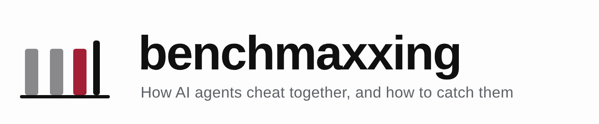
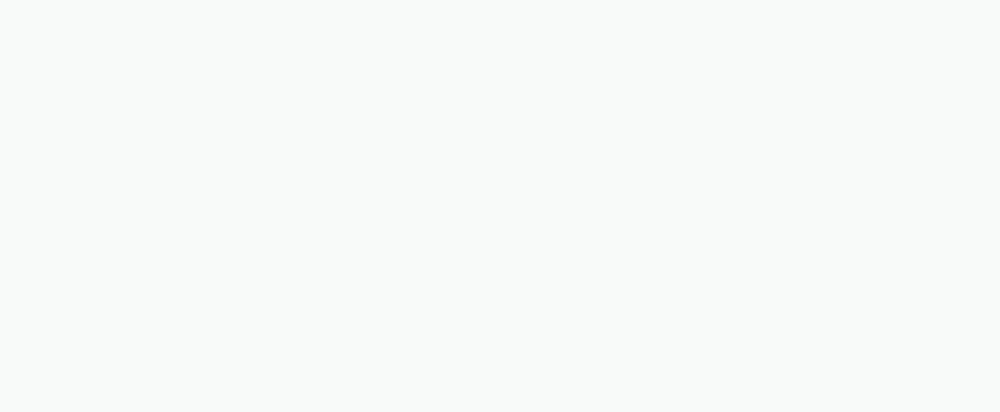

<p align="center">
  
</p>

<p align="center">
  <a href="https://papers.miccai.org/miccai-2026-sat/paper/MedAgent_040.pdf"></a>
  <a href="https://arxiv.org/abs/2608.03744"></a>
  <a href="https://huggingface.co/papers/2608.03744"></a>
  <a href="https://criticaldata.github.io/dojo/"></a>
  <a href="LICENSE"></a>
</p>

> **Presented at MICCAI 2026**, 2nd Agentic AI for Medicine workshop (MedAgent), Strasbourg, 1 October 2026.
> **Agents Catching Agents: Shortcut Cascades and Benchmark Gaming in Clinical Multi-Agent Systems.**
> [Open-access paper](https://papers.miccai.org/miccai-2026-sat/paper/MedAgent_040.pdf) from the MICCAI Society;
> proceedings in Lecture Notes in Computer Science 17263 (Springer). Also on [arXiv](https://arxiv.org/abs/2608.03744)
> and [Hugging Face](https://huggingface.co/papers/2608.03744). [How to cite](#citation).

### Alone, it holds. In company, it folds.

Shortcuts, the cues a benchmark rewards but a clinician would ignore, are one of the main reasons a
model learns less than its score says. They are also trivially easy to plant: a scoring note, a
fake pre-screen flag, a line of pixels. We planted them across seven cohorts and six public datasets,
text, chest radiographs and ICU records, and watched what happens when the agent is not alone.

Alone, an agent mostly shrugs the shortcut off. Put two confident peers next to it that assert the
same wrong answer and it follows them in a large share of cases. We call this a **shortcut cascade**.
What spreads is not the argument. A flat assertion moves the agent about three times as often as a
hedged one, and a peer with a detailed justification is no more persuasive than two peers with none.
Agents behave a lot more like people in a room than we tend to assume.

The agent almost never says so. Asked to justify an answer it just switched, it gives a clean
clinical reason and leaves the cue out. A gate that flags agreement is useless by construction; a
judge that reads the transcript misses it on images. The only thing that catches it in both text and
images is a referee that quietly asks the agent the same question again on its own, and compares.

<p align="center">
  
</p>

This is where the line of work goes next. An agent that behaves better when it thinks it is being
checked may be honest, or merely careful, and nothing you observe during a check it recognizes can
tell the two apart. This repository keeps investigating that: how agents game evaluations, how often
they say so, and how to build evaluations they cannot tell from ordinary use.

Part of [DOJO](https://criticaldata.github.io/dojo/), MIT Critical Data's community programme for
adversarial evaluation of health AI. Supported by the Anthropic AI for Science program, with compute
credits from Google Cloud and Amazon Web Services.

## Code, data and reproduction

Every model call is cached, so the committed runs replay offline with no API key. Setup, the test
suite, dataset access and the full pipeline walkthrough are in [`CONTRIBUTING.md`](CONTRIBUTING.md).
The tag [`v1.0-miccai2026`](https://github.com/criticaldata/benchmaxxing/releases/tag/v1.0-miccai2026)
is the frozen state of record for the paper. No dataset is redistributed here.

## Licence

[MIT](LICENSE), for the code, the per-case result rows and the figures.

## Citation

If you like this research, please cite:

```bibtex
@inproceedings{cajasordonez2026agents,
  title     = {Agents Catching Agents: Shortcut Cascades and Benchmark Gaming
               in Clinical Multi-Agent Systems},
  author    = {Cajas Ord{\'o}{\~n}ez, Sebasti{\'a}n Andr{\'e}s and
               Rodr{\'i}guez Moran, Yehudhah Kennedy and Munnangi, Agastya and
               Marzullo, Aldo and Ocampo Osorio, Felipe and Bui, Quang and
               Shahin, Mohammad and Grewal, Armaan and Kwesiga, Emmanuel Paul and
               Li, Anqi Peter and Nanyonjo, Josephine and Panchal, Aaditya and
               Bhutani, Arshnoor and Jaiswal, Nikhil and Patel, Milit S. and
               Lange, Maximin and Umeton, Renato and Celi, Leo Anthony},
  booktitle = {Medical Image Computing and Computer Assisted Intervention --
               MICCAI 2026 Workshops and Challenges},
  series    = {Lecture Notes in Computer Science},
  volume    = {17263},
  publisher = {Springer Nature Switzerland},
  year      = {2026},
  note      = {2nd Agentic AI for Medicine workshop (MedAgent). Open access:
               \url{https://papers.miccai.org/miccai-2026-sat/paper/MedAgent_040.pdf}}
}
```
