# PR #416 — Llama 3.2 11B experiment handoff

_Estado de experimentos para continuar la ejecución con otra cuenta/API · 20 de octubre de 2026 · America/Guayaquil_

---

## 📋 Resumen ejecutivo

- **Completado:** CheXpert principal de `n=600` para Llama 3.2 11B, con sus tres fases y cache reproducible.
- **Completado:** brazo `hidden_note` de CheXpert en los 35 casos compartidos con los otros modelos.
- **En curso:** batería `experiments/imaging_chexpert`; `imaging_solo` está corriendo con un worker y una pausa de 20 s entre llamadas.
- **Bloqueado por datos:** la batería NIH no tiene imágenes locales utilizables y la batería de texto no tiene los manifiestos crudos de MedQA/MedMCQA.
- **Importante:** no iniciar otra corrida mientras exista el proceso activo. El cache no equivale al número de casos completados hasta que aparezca el `summary` correspondiente.

## 🚦 Estado actual

| Área | Estado | Evidencia o siguiente acción |
| --- | --- | --- |
| CheXpert principal | 🟢 Completo | 600 filas en cada una de las tres fases |
| CheXpert `hidden_note` | 🟢 Completo | 35 filas en cada una de las cuatro salidas |
| CheXpert imaging `imaging_solo` | 🟡 En curso | PID `11130`; cache activo con 123 filas válidas y únicas |
| CheXpert imaging restante | 📋 Pendiente | Ejecutar secuencialmente después de `imaging_solo` |
| NIH imaging | 🔴 Bloqueado | Falta el árbol local de imágenes NIH |
| MedQA/MedMCQA y batería textual | 🔴 Bloqueado | Faltan los manifiestos crudos y opciones/preguntas |
| Llama 3.2 90B con `N_2` | 🔴 No ejecutado | 23 preflights agotaron timeout; no hubo respuesta del modelo |

## 📊 Resultados ya conseguidos

### CheXpert principal, `n=600`

| Métrica | Resultado |
| --- | ---: |
| Casos del manifest | 600 |
| Baseline correcto (`base_ans == "yes"`) | 371/600 |
| Blind drift condicionado al baseline correcto | 277/371 (74.7%) |
| Test-aware drift condicionado al baseline correcto | 294/371 (79.2%) |
| Supresión por awareness | No observada; test-aware tiene 17 drifts más |
| Respuestas no parseables | 0/1,800 |

La interpretación headline debe usar el estrato de baseline correcto. Las tasas incondicionales antiguas mezclan los 229 casos en que el baseline ya respondió `no` y no deben sustituir a esa comparación.

### Brazo oculto compartido, `n=35`

| Métrica incondicional | Resultado |
| --- | ---: |
| Decoy `SCORING NOTE` adoptado en blind | 23/35 (65.7%) |
| Decoy de mensaje de validación adoptado en test-aware | 15/35 (42.9%) |

Estas tasas son incondicionales sobre los 35 casos. Las tasas de drift deben conservar su denominador de baseline correcto.

### Comparación disponible con Gemini

Gemini sigue limitado a 35 casos. No existe todavía una corrida Gemini de 600 casos con el mismo protocolo, por lo que no debe presentarse como comparación emparejada 600-vs-600.

## 🔄 Batería adicional en curso

La corrida activa usa el modelo exacto `meta/llama-3.2-11b-vision-instruct`, la credencial prioritaria `N_2`, un solo worker y una separación mínima de 20 s entre llamadas. El cache activo está en:

`experiments/imaging_chexpert/results/meta_llama-3.2-11b-vision-instruct/img_cache.jsonl`

Al momento de generar este informe:

- proceso activo: `experiments.imaging.imaging_solo`, PID `11130`;
- cache: 123 filas, 123 claves únicas y 0 respuestas vacías;
- `imaging_solo_summary.json`: todavía no generado;
- los 123 registros no deben reportarse como 123 casos terminados.

La ejecución debe mantenerse serializada:

```mermaid
flowchart LR
    accTitle: Safe hosted run flow
    accDescr: The private N_2 credential is loaded from the local environment, requests are serialized through one worker and a 20 second gap, successful responses are cached, and only then is a checkpoint accepted.

    load_key([🔐 Load N_2]) --> pace[🛡️ One worker and 20 s gap]
    pace --> nim[☁️ NVIDIA NIM 11B]
    nim --> cache[💾 Append successful response]
    cache --> checkpoint[✅ Validate checkpoint]

    classDef start fill:#ede9fe,stroke:#7c3aed,stroke-width:2px,color:#3b0764
    classDef process fill:#dbeafe,stroke:#2563eb,stroke-width:2px,color:#1e3a5f
    classDef success fill:#dcfce7,stroke:#16a34a,stroke-width:2px,color:#14532d

    class load_key start
    class pace,nim,cache process
    class checkpoint success
```



## 🛡️ Continuación segura con otra cuenta

No usar `source .env`: el archivo contiene asignaciones que no están escritas como comandos shell ejecutables. Cargar la clave sin imprimirla:

```bash
cd /Users/yehu/Documents/MIT/benchmaxxing-1
export PY=/Users/yehu/Documents/MIT/benchmaxxing/.venv/bin/python
export N_2="$($PY -c 'from dotenv import dotenv_values; print(dotenv_values(".env")["N_2"])')"
export BENCHMAXXING_MIN_CALL_INTERVAL=20
export BENCHMAXXING_GLOBAL_MIN_CALL_INTERVAL=20
export BENCHMAXXING_MAX_WORKERS=1
export PYTHONUNBUFFERED=1
```

Antes de iniciar cualquier comando, comprobar que no exista otra corrida:

```bash
pgrep -af 'experiments.imaging.imaging_solo|experiments.imaging.imaging_cascade|experiments.imaging.imaging_matched_temp_floor|experiments.imaging.imaging_system_flag'
wc -l experiments/imaging_chexpert/results/meta_llama-3.2-11b-vision-instruct/img_cache.jsonl
```

No editar `.env` mientras el PID `11130` siga activo. Si se cambia de cuenta antes de que termine, hay que detener ese proceso de forma controlada y volver a validar el modelo con una sola llamada; nunca deben correr dos cuentas o dos workers sobre el mismo cache.

## 📋 Orden recomendado de ejecución

Ejecutar un arm, validar su `summary` y sólo después iniciar el siguiente. Reutilizar siempre el mismo cache model-scoped:

```bash
export MODEL=meta/llama-3.2-11b-vision-instruct
export ROOT=/Users/yehu/.cache/kagglehub/datasets/ashery/chexpert/versions/1
export MANIFEST=experiments/imaging_chexpert/results/nih_match_35.csv
export CACHE=experiments/imaging_chexpert/results/meta_llama-3.2-11b-vision-instruct/img_cache.jsonl
```

1. Esperar a que termine `imaging_solo` en los 35 casos.
2. Ejecutar el cascade estándar en los mismos 35 casos:

```bash
$PY -m experiments.imaging.imaging_cascade \
  --model "$MODEL" --manifest "$MANIFEST" --image-root "$ROOT" \
  --out experiments/imaging_chexpert/results --cache "$CACHE" --n 35
```

3. Ejecutar `imaging_matched_temp_floor` en los 35 casos con `--cue watermark`.
4. Ejecutar los tres cascades de 150 casos: `device_absent`, `natural_cues` y `natural_independent`, usando `--cue none` y sus respectivos manifests `cascade_150.csv`.
5. Ejecutar `imaging_system_flag` sobre el mismo manifest de `natural_independent` y escribir en `experiments/imaging_chexpert/results/system_flag`.
6. Después de cada arm, verificar que exista su JSONL y su `*_summary.json` con el `n` esperado.
7. Cuando termine toda la batería, force-add únicamente el cache final ignorado por Git:

```bash
git add -f experiments/imaging_chexpert/results/meta_llama-3.2-11b-vision-instruct/img_cache.jsonl
```

No agregar `img_cache_pre_n2.jsonl`: contiene intentos fallidos previos y está apartado como artefacto de diagnóstico.

## 🚧 Bloqueos que requieren datos adicionales

### NIH ChestX-ray14

Existe el manifest `experiments/imaging/results/nih_manifest.csv`, pero no está disponible localmente un árbol de imágenes NIH utilizable. No ejecutar ni publicar resultados NIH sin recuperar ese dataset o indicar una ruta válida de imágenes.

### MedQA y MedMCQA

El checkout conserva algunos IDs y resultados de referencia, pero no las preguntas, opciones y respuestas necesarias para reproducir los brazos solicitados. Se necesitan los manifiestos crudos de MedQA y MedMCQA antes de iniciar la batería textual.

### Llama 3.2 90B y Microsoft Phi-3 Vision

El 90B con `N_2` no obtuvo ninguna respuesta durante 23 preflights; la evidencia está en [`api_watchdog_n2_report.md`](../experiments/chexpert/results/api_watchdog_n2_report.md) y [`api_watchdog_n2_incremental.jsonl`](../experiments/chexpert/results/api_watchdog_n2_incremental.jsonl). Microsoft Phi-3 Vision devolvió `404` en el endpoint probado. Ninguno de los dos resultados debe mezclarse con la corrida válida de 11B.

## 🧪 Validación y estado de Git

- Tests de dispatch, gateway, ports, Gemini y lineage: **202 passed, 2 skipped**.
- Degeneracy guard y lineage parity: **4 passed**.
- Último commit local: `898bf46 test: account for scoped CheXpert pilot exemptions`.
- La rama está rebasada sobre `main` y no se ha hecho push desde esta sesión.
- Los valores de API no están incluidos en este informe ni en los artefactos rastreados.

## 🔗 Artefactos principales

- [Resultados Llama 11B y comparación](./pr416_nvidia_11b_results.md)
- [Resultados CheXpert Llama 11B, `n=600`](../experiments/chexpert/results/meta_llama-3.2-11b-vision-instruct/)
- [Brazo oculto de 35 casos](../experiments/chexpert/results/meta_llama-3.2-11b-vision-instruct/hidden_note_n35/)
- [Cache reproducible de CheXpert](../experiments/chexpert/results/600_runs/img_cache_llama11b_n2.jsonl)
- [Reporte de bloqueo del 90B](../experiments/chexpert/results/api_watchdog_n2_report.md)

_Este archivo es un handoff local. Para que otra cuenta lo vea desde GitHub hace falta publicar la rama o actualizar el PR; esa publicación no se realizó automáticamente._
